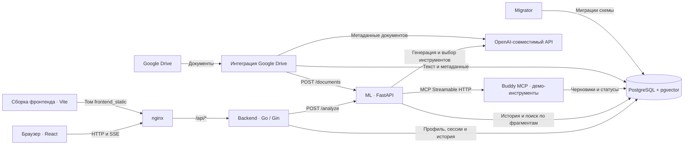

# Giga buddy (Кейс Авито)

### Локальный запуск

Понадобятся Docker с плагином Compose и GNU Make. Из корня репозитория
скопируйте [`.env.example`](.env.example) при первом запуске:

```bash
cp -n .env.example .env
```

Подставьте значения в локальном `.env`. `.env.example` служит шаблоном для
репозитория, а Docker Compose берёт настройки из `.env`.

| Переменные | Что указать |
| --- | --- |
| `DB_NAME`, `DB_USER` | Для новой БД можно оставить `buddy_db` и `buddy`. |
| `DB_USER_PASSWORD`, `JWT_SECRET` | Задайте отдельные случайные значения для БД и подписи токенов. Например, для каждого можно отдельно выполнить `openssl rand -hex 32`. |
| `OPENAI_BASE_URL`, `OPENAI_CHAT_MODEL`, `OPENAI_API_KEY` | Укажите адрес API, имя модели и ключ от выбранного провайдера. Пример для DeepSeek приведён ниже. |
| `ML_URL`, `BUDDY_MCP_URL` | В Compose оставьте `http://ml:8000` и `http://buddy-mcp:8000/mcp`. |
| `BUDDY_MCP_TOKEN`, `BUDDY_MCP_SUBMIT_TOKEN` | Задайте два разных случайных значения. Для подтверждения демо-заявок нужны оба. |
| `FOLDER_ID`, `GOOGLE_DRIVE_CREDENTIALS` | Для импорта укажите ID папки Drive и положите ключ в `secrets/google_drive_credentials.json`. В Compose путь внутри контейнера задаётся автоматически. [Настройка интеграции](integration/README.md). |
| `MESSAGES_PER_USER`, `DOCUMENTS_TO_CONTEXT` | Размер окна истории и число фрагментов для модели. Для демо можно оставить `10` и `5`. |
| `NGINX_PORT`, `ML_INFERENCE_MAX_WAITING` | Необязательные настройки. По умолчанию HTTP-порт — `80`, очередь ожидания ML — `2`. |

Если том PostgreSQL уже создан, используйте его текущие параметры подключения.
Изменение `DB_USER_PASSWORD` в `.env` само по себе пароль в существующей БД
не меняет.

### Команды Makefile

Выполняйте команды из корня проекта.

| Makefile | Docker Compose | Что делает |
| --- | --- | --- |
| `make` или `make up` | `docker compose up -d --build` | Собирает образы и запускает стек в фоне, включая `buddy-mcp`. |
| `make seed` | Три команды ниже | Поднимает PostgreSQL, применяет миграции и загружает тестовые учётки и данные. |
| `make down` | `docker compose down` | Останавливает стек и сохраняет тома. |
| `make down-v` | `docker compose down -v` | Останавливает стек и удаляет тома вместе с локальными данными PostgreSQL. |

Чтобы выполнить `make seed` напрямую через Docker Compose, запустите:

```bash
docker compose up -d --wait postgres
docker compose run --rm migrator
docker compose exec -T postgres sh -c 'psql -X -v ON_ERROR_STOP=1 -U "$POSTGRES_USER" -d "$POSTGRES_DB"' < infra/postgres/seed.sql
```

Для первого запуска с тестовыми учётками выполните `make seed`, затем
`make up` и откройте [http://127.0.0.1/](http://127.0.0.1/). Если порт 80
занят, добавьте `NGINX_PORT=8081` в `.env` и откройте
[http://127.0.0.1:8081](http://127.0.0.1:8081/). Для демо без Google Drive
используйте выборочный запуск из раздела [«Порядок проверки демо»](#порядок-проверки-демо).

### Версии зависимостей

| Компонент | Версия и источник зависимостей |
| --- | --- |
| Backend | Go 1.26.7 в [go.mod](backend/go.mod), образ сборки Go 1.27 |
| Frontend | Node.js 24, React 19.3.1, Vite 8.3.7, [package-lock.json](frontend/package-lock.json) |
| ML и Buddy MCP | Python 3.12, FastAPI 0.162.2, MCP 1.23.1, [requirements.txt](ml/requirements.txt) |
| Google Drive | Python 3.13 в Docker, Google API Client 2.201.0, [requirements.txt](integration/requirements.txt) |
| Хранилище и прокси | PostgreSQL 17 с pgvector 0.8.2, migrate 4.18.3, nginx 1.30.6, [Docker Compose](docker-compose.yml) |

### Внешние API и ключи

- **DeepSeek через OpenAI-совместимый API.** В шаблоне заданы
  `OPENAI_BASE_URL=https://api.deepseek.com` и `OPENAI_CHAT_MODEL=deepseek-flash`.
  Подставьте свой `OPENAI_API_KEY` в локальный `.env` и укажите модель,
  доступную для этого ключа. Для полного демо модель должна поддерживать
  вызов инструментов и потоковые ответы. Импорт Google Drive также использует
  JSON-ответ модели для метаданных документов.
- **Google Drive API.** Для импорта укажите `FOLDER_ID` и положите JSON-ключ
  сервисного аккаунта в `secrets/google_drive_credentials.json`. Подробности
  в [README интеграции](integration/README.md).
- **Buddy MCP.** Демо-инструменты работают внутри Docker. Укажите
  `BUDDY_MCP_URL=http://buddy-mcp:8000/mcp` и задайте два разных значения
  `BUDDY_MCP_TOKEN` и `BUDDY_MCP_SUBMIT_TOKEN` для чтения и отправки.

Используйте [`.env.example`](.env.example) как шаблон. Ключи и пароли
подставляйте в локальный `.env`. Задайте свой `JWT_SECRET` и пароль БД.

### Сервисы

- [Frontend](frontend/README.md) — интерфейс, дев-сервер и mock API.
- [Backend](backend/README.md) — HTTP API, сессии и чат.
- [ML и Buddy MCP](ml/README.md) — поиск по документам, генерация и инструменты демо.
- [Интеграция Google Drive](integration/README.md) — импорт документов и настройка ключа.
- [Nginx](nginx/README.md) — раздача интерфейса и прокси API.
- [PostgreSQL и migrator](infra/postgres/README.md) — хранение, миграции и тестовые данные.

### Архитектура



При отправке сообщения backend сохраняет вопрос и передаёт ML его ID и ID
пользователя. ML собирает контекст из истории и фрагментов базы знаний.
При включённом MCP модель может вызвать демо-инструменты. Фрагменты ответа
идут обратно через backend и nginx в браузер по SSE. После события `done`
backend сохраняет итоговый текст в истории.

При импорте интеграция сохраняет документ в PostgreSQL и уведомляет ML.
ML разбивает текст на фрагменты, строит векторы локальной ONNX-моделью
и записывает индекс в pgvector.

### Тестовые данные PostgreSQL

Из корня проекта с настроенным `.env` выполните команду, которая запускает PostgreSQL, применяет миграции и загружает данные в локальную БД.

```bash
make seed
```

Для входа используйте `admin` или `intern` с паролем `123`.
Скрипт добавляет историю чата, истёкшие сессии и черновики заявок. Повторный
запуск пропускает существующие записи. Таблицы `documents` и `document_chunks`
скрипт оставляет без изменений.

### Порядок проверки демо

Если эксперту нужно проверить чат и демо-действия без ключа Google Drive,
после настройки модели и MCP из корня проекта достаточно запустить:

```bash
make seed
docker compose up -d --build nginx ml buddy-mcp
```

1. Откройте [приложение](http://127.0.0.1/) и войдите как `intern` с паролем `123`.
2. В чате попросите подготовить заявку на чтение пространства `CAT-DEV`.
   Укажите причину, например «Нужен доступ для первой задачи стажировки».
   Проверьте поля черновика, отправьте показанную команду подтверждения
   отдельным сообщением и проверьте номер заявки и статус ожидания согласования.
3. Попросите ревью для PR №41. В демо у него красный CI с проверкой
   `unit-tests`. Затем запросите ревью для PR №42 у `demo-reviewer`,
   подтвердите черновик и проверьте номер операции.
4. Попросите оформить краткое отсутствие. Укажите будущие дату, начало,
   конец и часовой пояс, подтвердите черновик и проверьте статус заявки.
5. Для проверки основной базы знаний запустите полный стек с доступной
   папкой Google Drive и дождитесь `Synced N documents` в логах integration.
   Откройте импортированный документ в интерфейсе и задайте вопрос по его тексту.

Доступы, PR и отсутствие в пунктах 2–4 используют синтетические данные MCP.
Результаты действий сохраняются в PostgreSQL для текущего пользователя.

### Тесты и отчёты о покрытии

По условиям кейса покрытие строк прикладного кода команды должно превышать 80%.

- Frontend. В папке `frontend` выполните `npm ci` и `npm run coverage`.
  HTML-отчёт будет в `frontend/coverage/index.html`.
- Backend. Подготовьте отдельную PostgreSQL по [инструкции](backend/tests/README.md),
  задайте `TEST_DATABASE_URL` и выполните `bash backend/tests/run.sh`.
  HTML-отчёт будет в `backend/coverage/coverage.html`.
- ML и интеграция. Создайте отдельные виртуальные окружения из
  [инструкции ML](ml/README.md) и [инструкции интеграции](integration/README.md).
  Для выгрузки двух HTML-отчётов из корня выполните:

  ```bash
  .venv/bin/python -m pytest ml/tests --cov=ml/src --cov=ml/health --cov-report=html:ml/htmlcov
  integration/.venv/bin/python -m pytest integration/tests --cov=integration/src --cov-report=html:integration/htmlcov
  ```

